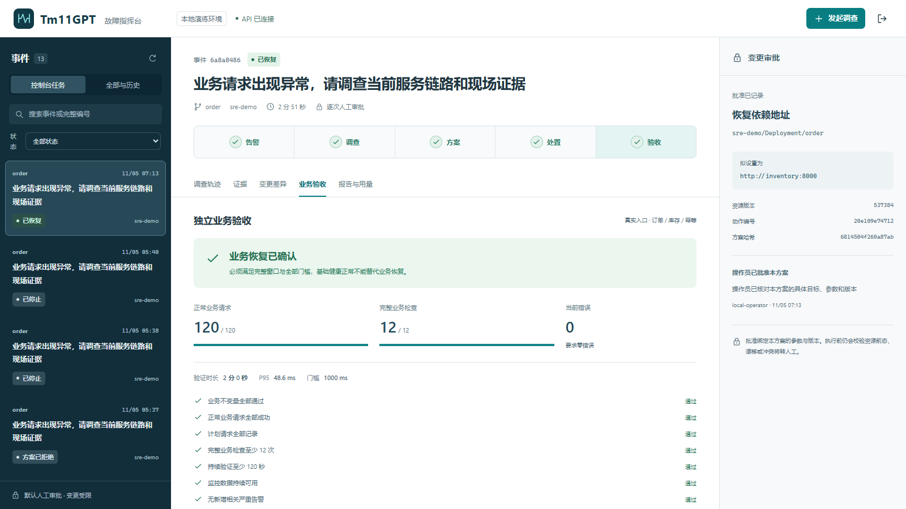
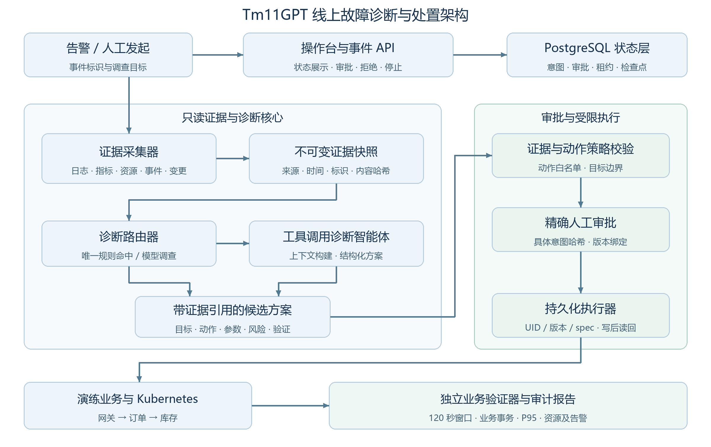
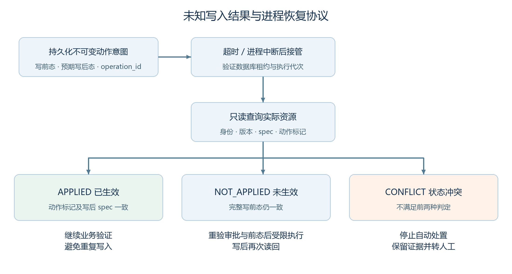

<div align="center">

# Tm11GPT

### 面向线上故障处理的云原生诊断与处置智能体

证据采集 → 诊断决策 → 人工审批 → 受控修复 → 业务验证

[](https://github.com/leekj666666/ucloud/actions/workflows/check.yml)


[观看演示视频](https://github.com/leekj666666/ucloud/releases/download/tm11gpt-v1.1/Tm11GPT-Demo.mp4) · [下载 Word 技术文档](docs/Tm11GPT-Technical.docx) · [下载参赛材料](https://github.com/leekj666666/ucloud/releases/download/tm11gpt-v1.1/Tm11GPT-Submission.zip)

</div>

Tm11GPT 面向研发、运维和平台工程师的线上故障处置场景，将跨系统调查、修复审阅、受限执行和业务恢复验证连接为可追溯的工作流。系统不仅说明“可能哪里出错”，还保留修改依据、具体审批、执行前后状态以及真实业务验收结果。

| 正确处置 | 独立业务恢复 | 模型 token 用量下降 | 可靠性与交互验收 |
| :---: | :---: | :---: | :---: |
| **119/120 · 99.17%** | **101/120 · 84.17%** | **约 79.9%** | **7 项实机控制链路 + 3 项浏览器流程** |

正确处置包括独立验证恢复及符合场景期望的安全转人工。120 项采用修复后关联补测合并口径：114 项原结果 + 6 项对应现场补测；调用成本来自首次完整运行，详见下方评测章节。

**阅读导航：** [Demo 与交互](#demo-与交互) · [系统架构](#系统架构) · [核心技术](#核心技术) · [创新设计](#创新设计) · [效果与对照](#效果与对照) · [运行与复现](#运行与复现) · [迭代记录](#迭代记录)

## Demo 与交互

**正式 Demo 为约 3 分钟演示视频。** [下载 MP4](https://github.com/leekj666666/ucloud/releases/download/tm11gpt-v1.1/Tm11GPT-Demo.mp4)，或直接打开参赛包中的 `03-Tm11GPT-Demo.mp4`。无需访问开发者电脑、登录控制台或配置 API Key。源码可用于补充运行与复现。

视频包含真实界面的发起调查、证据与方案审阅、人工批准、修复过程、业务验收、报告导出及结果对比；慢放、加速和真实停帧均在画面中标注。

| 时间 | 演示内容 |
| --- | --- |
| 00:00–00:05 | 项目与场景 |
| 00:05–00:30 | 发起调查表单，展示事件输入与提交 |
| 00:30–00:46 | 调查与阶段状态 |
| 00:46–01:18 | 方案审阅、人工审批与执行 |
| 01:18–02:18 | 业务窗口与恢复结果 |
| 02:18–02:36 | 报告与导出 |
| 02:36–03:00 | 效果对比 |



控制台采用左侧事件列表、中间五阶段闭环、右侧方案审批的布局。操作员可以批准、拒绝或停止任务；结束后导出 JSON / Markdown。JSON 单行紧凑编码是合法格式，结构化字段保持完整。

## 系统架构

控制面、只读诊断、受限执行和独立验证构成四个职责边界。



| 组件 | 职责与边界 |
| --- | --- |
| 事件API与操作台 | 接收告警或手动任务，展示证据、方案及结果，提交操作员决定 |
| 持久化状态层 | 保存事件状态、租约、动作意图、审批及审计检查点 |
| 诊断核心 | 读取实际观测，形成快照，进行规则路由或模型工具调查 |
| 执行与验证 | 校验具体变更并读回真实状态；独立验证器检查业务事务 |

业务演练图包含网关、订单和库存服务。指标/告警服务与日志服务提供观测；验证器经实际服务网络路径发起请求。诊断进程不持有执行身份，执行进程不持有模型API Key。资源观察器只提供只读采样文件，不向工作进程开放容器管理接口。

## 核心技术

### 证据快照与诊断上下文

统一证据结构使推理结果能够回到实际观测，而不是停留在一段无法核对的说明。

| 证据类别 | 关键内容 | 作用 |
| --- | --- | --- |
| 当前资源 | 资源标识、UID、版本、公开配置和spec哈希 | 确定目标及当前前态 |
| 运行状态 | Pod状态、OOM/重启、端点及事件 | 识别实际故障征象 |
| 可信基线 | 独立验证过的健康配置与验证引用 | 约束可恢复目标值 |
| 发布历史 | 版本、归属、创建时间和配置变化 | 支持变更关联与反证 |
| 故障日志 | 原始行、查询条件、时间窗及关联地址 | 支持目标相关症状 |
| 请求指标 | 服务、HTTP状态、请求率等 | 补充业务表现与影响 |

#### 证据记录与引用

每条证据包含唯一ID、类型、来源、采集时间、实际数据和内容哈希。模型方案引用的是这些记录ID，而不是工具调用ID或模型自造编号。进入模型的压缩视图保留资源身份、公开配置和相关状态；原始数据保留在同一任务的证据目录，便于核对压缩前后的内容。

#### 快照边界

每次诊断形成独立快照，重复读取相同快照不会凭空增加新证据。采集异常被显式记录为collection_error，不能当作“查询成功但无异常”。最终方案及报告保留快照哈希，使诊断输入、方案引用与执行检查点可以关联。

#### 时间与因果

日志查询从事件时间窗开始，发布记录提供时间线但不直接作为根因证明。近期无关发布、健康依赖端点和正常业务拒绝都可能构成反证。系统同时检查目标、配置变化与实际症状，避免仅凭“最近改过”就回滚。

### 诊断核心与规则模型协同

诊断核心由采证器、快照压缩器、工具调用调度器、模型接口客户端、方案解析器和策略路由器组成。

#### 诊断路由

规则层从同一组实际观测中生成候选动作。仅当证据完整、规则支持且候选唯一时直接提交待审方案；无匹配、多候选或采集异常时，进入模型工具调查。模型可读取六类证据、解释支持与反证，并输出受限方案或转人工。两条路径没有不同的执行特权。

| 支持动作 | 目标范围 | 关键证据约束 |
| --- | --- | --- |
| 恢复依赖地址 | 订单或网关的指定公开环境变量 | 实际配置漂移、可信目标值、依赖状态及相关症状 |
| 恢复服务端口 | 允许名单内Service的targetPort | 基线端口与真实工作负载端口一致 |
| 恢复副本数 | 允许名单内Deployment | 当前副本数为0，健康基线为1至2 |
| 恢复资源配置 | 允许名单内Deployment容器 | 目标OOM证据及对应健康资源配置 |

#### 结构化方案接口

方案包含action、resource、expected_spec_hash、value、reason和evidence_ids。地址恢复值为字符串，副本数为整数，资源恢复值为对象；转人工的value为null。类型不正确、目标不匹配或引用不成立时，不依靠模糊修补自动授权执行。

#### 受限自主决策

模型负责在观测范围内选择调查工具并给出处置建议，不拥有任意代码执行权。当前工具循环步数上限为8、输出token上限为8192，任务级超时与HTTP账本约束另行生效。已通过真实模型回退场景：遇到不支持的故障时完成调查并正确转人工，保留了实际调用用量。

### 精确审批与动作前态约束

人工批准针对一份具体且不可变的动作方案，不是对后续任意变更的笼统授权。

#### 方案身份

动作意图记录目标资源、动作ID、当前UID与resourceVersion、完整spec前态、目标配置、结果spec哈希及健康基线引用。控制台展示拟修改参数、目标版本和方案哈希，操作员核对后才能批准；拒绝和停止分别进入持久化审计。

#### 分派前检查

执行前重新读取目标，核对资源UID、当前版本和完整spec。目标被重建、资源发生漂移或方案参数发生变化时，原批准不能继续授权不同动作。执行身份还受到命名空间、资源类型和资源名称名单约束。

#### 审批与停止竞争

审批决定按动作身份和意图哈希绑定。停止请求持久化后，后续分派检查必须确认停止状态。对于已经在途的请求，先查明实际执行结果，避免把“已请求停止”错误显示成“变更一定没有发生”。已应用的动作不因用户停止而自动撤销。

| 场景 | 系统行为 | 本轮实机观察 |
| --- | --- | --- |
| 拒绝待审方案 | 保存拒绝决定，不执行资源修改 | REJECTED，写入0次 |
| 批准前停止 | 终止后续调查/动作并确认子进程终态 | CANCELLED，写入0次 |
| 批准后写入前停止 | 停止决定继续约束后续分派和重启恢复 | CANCELLED，写入0次 |

诊断输出、审批记录和资源变更是三个不同层次。方案有效不等于已经获得批准；批准成功不等于资源已修改；资源已修改也不等于业务已经恢复。

### 持久化执行与中断恢复

恢复过程围绕同一动作意图读回实际状态，减少重复变更和未知结果带来的风险。



#### 检查点与租约

工作流按事件持久化阶段与执行上下文。数据库租约和代次区分当前所有者；旧所有者失去有效连接或租约后，不能继续提交检查点。同一业务依赖图使用保守互斥，独立业务图才允许并发。

#### 三态读回

若目标的动作标识与结果spec哈希一致，识别为已生效，继续验证而不再次patch。若UID、resourceVersion、spec与动作标识均符合原前态，识别为未生效，按有效租约、审批和策略决定后续。其余情况视为冲突并转人工，不覆盖未知外部变更。

真实进程SIGKILL分别覆盖写入前、写入后：重启后继续同一事件与方案，最终业务窗口通过，两项各只有一次实际资源写入。该结果证明已测场景下的重复写入抑制与状态重建，不把外部API行为描述为通用分布式事务。

### 异步日志补采与症状关联

让诊断等待真实证据到达，而不是凭配置差异推造故障证据。

#### 问题来源

路径配置故障返回上游404时，业务记录inventory_rejected；旧查询只覆盖inventory_unavailable，且拒绝日志没有上游地址。另一次产品接入中，事件启动约3秒即读取日志，查询为空，而同时间窗事后查到了3条日志。两类问题分别是事件覆盖不足和异步运输延迟。

#### 结构化关联条件

拒绝日志补充真实upstream和request_path。对路径漂移修复，要求service为order、实际状态为404、上游地址精确等于当前配置、操作路径为/reservations、当前与健康地址同源但路径不同，同时具有健康依赖端点和有效健康基线。409/422等正常业务拒绝、缺字段或地址不匹配不能满足该条件。

#### 有界补采

首次日志为空且采集没有报错时，执行最多6次补采，每次间隔3秒，等待预算约18秒；单次网络请求还受自己的超时约束，因此不把18秒当作端到端时延保证。一旦取得实际日志、出现采集错误或到达预算边界，就停止继续等待。

#### 可审计证据序列

保留首次空结果和各次实际查询响应，补采产生新记录ID与内容哈希。最终快照采用实际得到的记录，不向过去扩展故障起始时间，不从标准答案补字段，也不覆盖旧任务的观测。

两种对应配置各进行3次新现场验证，6/6通过完整业务恢复门槛，模型HTTP调用为0。正常业务拒绝、缺字段、错误地址和采集失败等负例另有测试覆盖。

### 独立业务恢复验证

恢复由独立程序检查实际业务事务，诊断核心不能自行宣布成功。

#### 业务级验证路径

验证器经真实网络入口访问网关、订单与库存服务，完成下单、订单查询、库存变化核对、重复提交幂等与数据清理。验证使用独立测试租户和幂等请求标识，避免将演练清理扩大到正常业务数据。

| 门槛 | 判断要求 |
| --- | --- |
| 完整窗口 | 持续时间至少120秒 |
| 请求与事务 | 至少120次负载请求、至少12次完整业务检查 |
| 请求与不变量 | 请求成功、业务不变量及验证租户清理全部通过 |
| 观测完整性 | 监控可用，并取得容器资源采样 |
| 告警 | 窗口中没有新增相关严重告警 |
| 延迟 | P95不高于冻结基线两倍与1秒中的较大值 |
| 采样时序 | 按既定节奏采样，负载请求调度延迟须低于1秒 |

#### 对假健康的识别

受测服务可能仍返回/health成功，或旧Pod仍能提供部分流量，但新订单事务失败。系统不将端点Ready、健康探针成功或HTTP无5xx直接视为恢复；路径404在该业务中可表现为订单409，仍须由事务验证判为失败。

#### 当前演示实例

真实浏览器事件6a8a8486-7be6-4670-9e4c-1fed083d55ff经人工批准后恢复依赖地址。完整120秒窗口内120次请求成功、12次业务检查通过、错误0，P95约48.6ms，本机门槛1秒。拒绝和取消事件保留自己的终态，不生成已验证恢复声明。

## 创新设计

创新重点是诊断、授权、执行与验证之间的连接机制，以及针对实际失败的可验证改进。

#### 证据绑定的处置闭环

将证据ID、资源身份、方案参数和实际恢复结果连接到同一事件。模型输出不能绕过引用与前态校验，规则路径也不能省略审批。价值在于让“为何修改、批准了什么、实际是否生效”能够逐项核查，而不只生成一段排障建议。

#### 规则与模型共享上下文和验收

明确规则承担可重复、低成本的确定性处置建议，复杂或不确定情形交给模型工具调查。两条路径使用同一观测范围和执行/验证门槛，减少只比较文字质量或使用不同执行接口造成的评价偏差。首次完整运行中规则路径占96/120，体现了这一设计在当前故障配置范围内的效率价值。

#### 未知写入结果的状态重建

将不可变动作意图、分派记录和资源读回结合，在进程被强制结束或响应丢失时重建真实执行状态。已测写前/写后中断均只产生一次实际修复写入，为长链路任务恢复提供工程依据。

#### 异步观测与业务语义共同参与决策

对真实日志覆盖缺口与运输延迟进行有界补采，并以操作、地址和状态关联症状；随后仍由订单与库存事务验收。它同时处理“证据尚未到达”和“资源看似健康但业务失败”这两种常见误判来源。

#### 成果表达边界

上述贡献属于面向具体场景的系统设计和工程改进，不能仅凭这些结果主张所有机制均为首次提出。效果来自已知配置、控制链路及真实浏览器验证；未将本地演练描述为企业生产部署或第三方盲测。

## 效果与对照

| 方案 | 正确处置 | 业务恢复 |
| --- | --- | --- |
| 开源诊断对照 | 98/120  81.67% | 81/120  67.50% |
| 原模型方案 | 103/120  85.83% | 86/120  71.67% |
| Tm11GPT 修复后合并 | 119/120  99.17% | 101/120  84.17% |

正确处置指已独立验证恢复，或面对预期应转人工的场景作出正确的安全转人工决定。Tm11GPT在该合并口径下相对两组对照分别高17.50和13.33个百分点；这一数值不是“所有故障恢复率”。

#### 合并统计与追溯

原矩阵共120个用例槽位。对应日志缺口的6个原失败槽位，经修复后新现场补测均通过；合并汇总保留114项原结果并替换这6项。原始记录、配置与重复编号、补测来源及文件哈希保留，分母不增加；没有把它描述成一次新版全量重测。其余一个未达标案例仍保留失败。

#### 实际调用成本

首次120项完整运行的已知token为358,760，相比原模型方案1,784,509减少约79.9%；HTTP尝试48相比236减少约79.7%。这些成本取自首次完整运行账本，不按合并结果重新虚构一次完整运行费用。诊断P50约4.21秒、P95约33.08秒，均不包含完整事件的发布等待及120秒业务窗口。

真实模型回退验收为2次HTTP、14,253已知tokens；规则闭环实例为0次模型调用。基础设施仍有资源消耗。未核对输入/输出/缓存费率与日期时，费用金额保持未知，不能由0模型调用推导整套系统0成本。

#### 可靠性证据

7项实机控制链路、3项浏览器流程通过；名称调整后的实际页面又完成审批恢复及导出复验。完整后端289项测试和12项浏览器契约已通过对应提交的CI。测试通过、当前场景恢复和生产泛化是不同结论。

### 已通过的真实控制链路

| 验收场景 | 结果 | 实际资源修复写入 |
| --- | --- | ---: |
| 人工批准 | 完整业务窗口通过 | 1 |
| 拒绝方案 | REJECTED | 0 |
| 停止任务 | CANCELLED | 0 |
| 写入前强制结束进程并恢复 | 同一事件恢复，完整窗口通过 | 1 |
| 写入后强制结束进程并恢复 | 读回已生效动作，完整窗口通过 | 1 |
| 批准后停止并重启 | 停止决定保留 | 0 |
| 不支持故障的真实模型回退 | 调查后正确转人工 | 0 |

### 证据与统计入口

- [逐项合并映射及文件哈希](docs/history/TM11GPT_COMBINED_RESULTS.json)：保留原始失败、补测来源与对应槽位。
- [持续集成记录](https://github.com/leekj666666/ucloud/actions/workflows/check.yml)：实际 PostgreSQL 集成测试、镜像构建、前端构建及浏览器契约；对应提交状态以工作流结果为准。
- 演示报告来自真实事件 `6a8a8486-7be6-4670-9e4c-1fed083d55ff`，参赛包保留脱敏 JSON 报告。

## 运行与复现

### 环境与依赖

| 层次 | 配置与用途 |
| --- | --- |
| 操作系统 | 已验收 Windows + Ubuntu 24.04 WSL2；部署脚本在 Linux / WSL 中运行 |
| 开发工具 | Python 3.12+、uv 0.13.5；前端验收使用 Node 24.22.1 与 npm |
| 容器与集群 | Docker、kubectl、kind；业务服务、数据库、指标与日志基础设施 |
| 模型服务 | 兼容接口地址、模型名及独立 API Key；已验收 DeepSeek 官方接口 |
| 资源 | 开发机 16GB 内存；不需要本地 GPU。并非对所有部署的最低内存保证 |
| 依赖固定 | 后端 `uv.lock`；前端 `frontend/package-lock.json`；工具运行环境固定提交与锁文件 |

### 取得源码与构建

在 Linux / WSL 终端执行。部署脚本当前默认工作目录为 `~/sre-project`，因此先按该位置准备源码。

```bash
git clone https://github.com/leekj666666/ucloud.git ~/sre-project
cd ~/sre-project
git checkout tm11gpt-v1.1
uv sync --frozen
cd frontend
npm ci
npm run build
cd ..
```

工具调用运行组件在独立 `.venv-holmes` 环境安装，源码固定提交见 `docs/DIAGNOSTIC_COMPONENT_PIN.txt`，依赖见 `docs/HOLMESGPT-REQUIREMENTS.lock`。部署脚本同时引用 `vendor/holmesgpt` 和该虚拟环境，二者须提前准备，不使用未固定的最新版替代。

### 私密配置与启动顺序

模型私密文件在当前脚本中默认读取 `/mnt/d/uclaude/model.env`，字段如下。将占位符替换为自己的有效配置，文件保留在仓库外。

```dotenv
OPENAI_BASE_URL=<模型接口地址>
DEEPSEEK_API_KEY=<自己的密钥>
MODEL_NAME=<账号实际可用的模型名>
```

首次部署还需按 `infra/` 配置数据库、容器网络及观测组件；已有脚本包含 `~/sre-tools` 等本地工具路径。下表是分层入口与前置关系，不是无需准备的空白主机一键安装命令。

| 顺序 | 入口 | 作用与要求 |
| --- | --- | --- |
| 1 | `scripts/deploy_d1.py` | 部署真实业务与观测基础设施；需要有效基础设施配置和本地工具/镜像 |
| 2 | `scripts/provision_d3_rbac.py` | 生成只读诊断与受限执行身份，限定目标范围 |
| 3 | `scripts/prepare_d4_baseline.py` | 对当前实际业务镜像完成独立健康验证，生成基线 |
| 4 | `scripts/deploy_d4_runtime.py --no-workers` | 构建控制台与任务容器；检查并显式启动所需工作进程 |
| 5 | 控制台 | 登录后针对隔离演练环境发起调查、逐次审批并等待完整验收 |

运行前核对数据库、两组命名空间、模型端点、工具环境、验证器、资源观察器、基线与镜像。凭证仅留 `infra/.generated` 等私密位置；Kubernetes 短期令牌到期后需续签。界面创建任务不会自动注入故障，演练故障应在隔离场景中准备。

`CLOUDSRE_ROUTING_MODE=h5` 是当前路由兼容配置名，最终产品仍统一命名为 Tm11GPT；旧名称不代表对外另一个版本。额外反馈重规划分支关闭，默认逐次人工审批。

### 验证代码与操作流程

配置独立的 `SRE_TEST_DATABASE_URL` 后执行：

```bash
uv run ruff check backend tests scripts diagnosis benchmarks
uv run pytest tests -q -ra
```

完整工作流还会执行镜像构建、前端锁定依赖构建、12 项浏览器契约和告警规则验证。未配置 PostgreSQL 导致的跳过不能作为完整通过记录。

交互顺序为：准备故障 → 发起调查 → 阅读证据与具体变更 → 批准或拒绝 → 执行与完整 120 秒业务验证 → 导出报告。调查期间可停止。拒绝、取消与安全转人工有各自终态，不显示为业务恢复。

当前完成同主机清洁部署与最终页面实机验收；新版尚未在完全空白的另一台主机完成全流程复现。视频为正式展示入口，源码为可检查、可配置运行的补充材料。

## 迭代记录

以下名称只用于解释实验历史。对外产品及当前方案统一为 **Tm11GPT**。

| 阶段 | 调整内容 | 验证结论 |
| --- | --- | --- |
| 初始规则基线 B0 | 用确定性规则检验业务、动作和独立验证链路 | 建立可重复的控制基线 |
| 工具调用对照 B2 | 修复共同接口与证据引用适配后重新评测 | 冻结正确处置 98/120、恢复 81/120；早期接入失败 0/60 不代表组件能力 |
| 原模型方案 B3 | 在共同执行与验收条件下运行模型诊断 | 正确处置 103/120、恢复 86/120 |
| 反馈重规划候选 H2b | 评估失败反馈与再规划 | 目前关闭该额外分支，不作为最终产品默认能力 |
| 协同诊断候选 H5 | 唯一规则先行、模型回退，接入相同审批与验证 | 首次完整矩阵正确处置 113/120、恢复 95/120 |
| 最终 Tm11GPT | 补齐路径错误日志、地址关联与异步补采，接入产品 | 六项现场补测 6/6；合并正确处置 119/120、恢复 101/120 |

后续扩展重点是更多业务图与故障类型、不同环境中的全量重测、部署自动化与更完整的模型费用分项统计。当前实测结果与未完成扩展保持区分。

## 仓库结构

```text
backend/cloudsre/    事件 API、持久化工作流、动作策略与验证
frontend/           中文故障指挥台
diagnosis/          证据工具、模型接口及诊断路由
infra/  deploy/     观测与业务部署配置
scripts/            分层部署、校验与评测工具
tests/              后端与浏览器契约测试
benchmarks/         故障案例与评测逻辑
docs/assets/        架构图和真实页面
docs/history/       结果对应、补测映射与哈希
```

[完整 Word 技术文档](docs/Tm11GPT-Technical.docx) · [发布与演示视频](https://github.com/leekj666666/ucloud/releases/tag/tm11gpt-v1.1)
