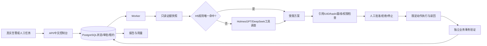

# 参赛技术说明：云巡 SRE Agent

赛道B：云原生智能体应用与场景创新。当前路线H5，默认逐次人工审批，H2b关闭。

## 用户与价值
面向中小研发团队的值班研发/平台工程师。故障处置需要跨日志、指标、资源状态、发布历史查证，盲目回滚可能引入新问题，健康检查成功也可能掩盖订单失败。项目把采证、方案审阅、受控执行、业务恢复验证及归档接成可审计闭环。没有虚构客户、访谈或生产收益数据。

## 架构与技术选型

业务图为gateway/order/inventory。Prometheus与Alertmanager负责指标告警，Loki与Alloy负责日志。Kubernetes运行受测微服务，诊断、worker和验证器分离。PostgreSQL租约和检查点管理并发与恢复，避免在16GB开发机堆叠更多队列基础设施。未宣称已实现HPA、任意多云管理或企业SSO。

## Agent与工具
六类证据：当前资源、运行状态、健康基线、发布历史、日志、请求指标。模型仅获得只读工具及实际快照，不获得故障注入答案、执行凭证或评分器。工具内容视为数据而不是指令。模型可提出四类受限动作或转人工。H5规则覆盖明确可验证情形；不命中、存在多候选或采集失败时交由模型调查。规则命中仍须经过同一授权与人工审批，不能自动越权。

模型回退已使用真实官方接口验收，模型调用两次后正确识别不支持的故障并转人工。不能用规则路径0模型调用的成功录像代替全部模型能力证据。模型名称和思考模式以运行配置及账本为准，不从产品别名推断未记录的模型版本。

## 安全、状态与恢复
批准绑定当前方案参数、动作ID及哈希。执行前校验UID、resourceVersion、完整spec、可信健康基线、目标名单和症状证据。诊断身份不可patch；执行身份仅允许名单内资源。超时后先读回实际状态再决定继续，避免重复写入。停止与在途请求分开确认；已应用的修复不因停止而自动撤销。

真实SIGKILL覆盖写前、写后以及批准后停止：恢复同一事件/方案，成功修复实际写入一次；拒绝或停止路径写入为零。持续资源观测由独立观察器提供，worker没有Docker socket。

## 日志补采改进
上游路径404记录inventory_rejected，旧查询只覆盖inventory_unavailable，且旧拒绝日志缺少上游地址。新增真实upstream/request_path字段，扩大采集，并仅在同源路径漂移、HTTP404、服务/操作/地址精确匹配、上游Ready及可信基线约束满足时支持恢复。409/422等正常业务拒绝不据此修复。增加最多约18秒等待的有限只读补采，保存空结果与后续结果，不推造证据或回填旧成绩。

## 恢复判据
独立验证器通过真实Service/NodePort路径执行下单、订单读回、库存扣减、幂等和清理。恢复必须满足完整120秒、至少120次负载请求、12次业务核验、无错误、监控/资源采样、P95与采样时序门槛。仅资源Ready、仅/health正常或模型自报成功均不足以宣称业务恢复。

## 结果、成本与限制
|范围|恢复|正确处置|说明|
|---|---:|---:|---|
|冻结共同接口B2|81/120|98/120|历史对照|
|共同接口B3|86/120|103/120|历史对照|
|补强前H5扩大验证|95/120|113/120|后续已知配置验证|

历史已知tokens：B2 5,581,302；B3 1,784,509；H5 358,760。H5相对历史B3约下降79.9%；HTTP48相对236约下降79.7%。非同步随机盲测，不能据此保证全面优于成熟产品。H5诊断P50约4.21秒、P95约33.08秒，非完整事件端到端耗时。

新版补采6/6恢复、模型HTTP0次、错误授权0；7项控制链路和3项浏览器验收通过。三组不是一个统计分母，不能拼接成新版101/120。相关100项回归与12项补采/路由测试存在重叠。最新整合提交CI状态另行记录，不引用旧CI冒充新版本通过。

每次实际HTTP、失败/重试、usage未知均保留。模型回退验收为2次HTTP、14,253已知tokens；规则成功病例0调用不等于基础设施0成本。没有核对费率和缓存拆分时，金额保持未知；预算公式为输入/输出/缓存tokens各乘对应有日期费率，再加部署资源成本。

本项目采用成熟开源基础，工程贡献见CONTRIBUTIONS.md。未完成第三方盲测、真实企业生产验证；当前新版未重跑完整120项矩阵。H2b保持关闭，不为了复杂度强制启用。后续价值验证优先真实值班研发试用和未见组合场景。

## 演示与提交
随包提供180秒真实字幕录像、部署/操作说明、验收报告和示例JSON/Markdown。视频注明剪辑与加速，成绩页为历史版本观察。简历、身份及联系方式由参赛人自行填写；本仓库不保存这些个人材料或任何密钥。
