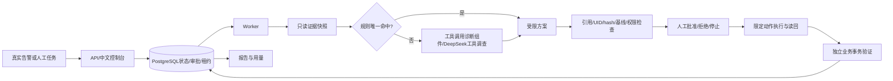

# 参赛技术说明：Tm11GPT

赛道B：云原生智能体应用与场景创新。当前最终方案，默认逐次人工审批，额外反馈重规划分支关闭。

## 用户与价值
面向中小研发团队的值班研发/平台工程师。故障处置需要跨日志、指标、资源状态、发布历史查证，盲目回滚可能引入新问题，健康检查成功也可能掩盖订单失败。项目把采证、方案审阅、受控执行、业务恢复验证及归档接成可审计闭环。没有虚构客户、访谈或生产收益数据。

## 架构与技术选型

业务图为gateway/order/inventory。Prometheus与Alertmanager负责指标告警，Loki与Alloy负责日志。Kubernetes运行受测微服务，诊断、worker和验证器分离。PostgreSQL租约和检查点管理并发与恢复，避免在16GB开发机堆叠更多队列基础设施。未宣称已实现HPA、任意多云管理或企业SSO。

## Agent与工具
六类证据：当前资源、运行状态、健康基线、发布历史、日志、请求指标。模型仅获得只读工具及实际快照，不获得故障注入答案、执行凭证或评分器。工具内容视为数据而不是指令。模型可提出四类受限动作或转人工。规则覆盖明确可验证情形；不命中、存在多候选或采集失败时交由模型调查。规则命中仍须经过同一授权与人工审批，不能自动越权。

模型回退已使用真实官方接口验收，模型调用两次后正确识别不支持的故障并转人工。不能用规则路径0模型调用的成功录像代替全部模型能力证据。模型名称和思考模式以运行配置及账本为准，不从产品别名推断未记录的模型版本。

## 安全、状态与恢复
批准绑定当前方案参数、动作ID及哈希。执行前校验UID、resourceVersion、完整spec、可信健康基线、目标名单和症状证据。诊断身份不可patch；执行身份仅允许名单内资源。超时后先读回实际状态再决定继续，避免重复写入。停止与在途请求分开确认；已应用的修复不因停止而自动撤销。

真实SIGKILL覆盖写前、写后以及批准后停止：恢复同一事件/方案，成功修复实际写入一次；拒绝或停止路径写入为零。持续资源观测由独立观察器提供，worker没有Docker socket。

## 日志补采改进
上游路径404记录inventory_rejected，旧查询只覆盖inventory_unavailable，且旧拒绝日志缺少上游地址。新增真实upstream/request_path字段，扩大采集，并仅在同源路径漂移、HTTP404、服务/操作/地址精确匹配、上游Ready及可信基线约束满足时支持恢复。409/422等正常业务拒绝不据此修复。增加最多约18秒等待的有限只读补采，保存空结果与后续结果，不推造证据或回填旧成绩。

## 恢复判据
独立验证器通过真实Service/NodePort路径执行下单、订单读回、库存扣减、幂等和清理。恢复必须满足完整120秒、至少120次负载请求、12次业务核验、无错误、监控/资源采样、P95与采样时序门槛。仅资源Ready、仅/health正常或模型自报成功均不足以宣称业务恢复。

## 效果与工程价值
正确处置119/120（99.17%），业务独立恢复101/120（84.17%）；采用114项原始结果加6项匹配修复补测的合并口径。对照及来源见[结果对比](RESULTS.md)。重点价值是减少无依据的变更、让审批可核对、避免中断后的重复执行，以及用业务事务而非健康探针确认恢复。

诊断核心由证据采集器、快照压缩器、工具调用调度器、兼容API的模型客户端、结构化方案解析器及策略路由器组成。项目自主工作涵盖事件编排、证据与动作约束、审批/停止、执行重建、业务验证和操作台；通用工具调用组件等开源基础的归属见独立附录，不将这些组件的源码作为自主开发成果。

首次完整评测相对原模型方案已知token量下降约79.9%、HTTP尝试下降约79.7%；完整事件耗时包含发布等待与120秒业务窗口，不能与诊断耗时混用。每次失败、重试与未知usage保留，缺少费率依据时金额不填零。项目已在本地演练集群验证，未声称企业生产验证。

## 演示与提交
随包提供180秒真实字幕录像、部署/操作说明、验收报告和示例JSON/Markdown。视频注明剪辑与加速，成绩页为历史版本观察。简历、身份及联系方式由参赛人自行填写；本仓库不保存这些个人材料或任何密钥。
