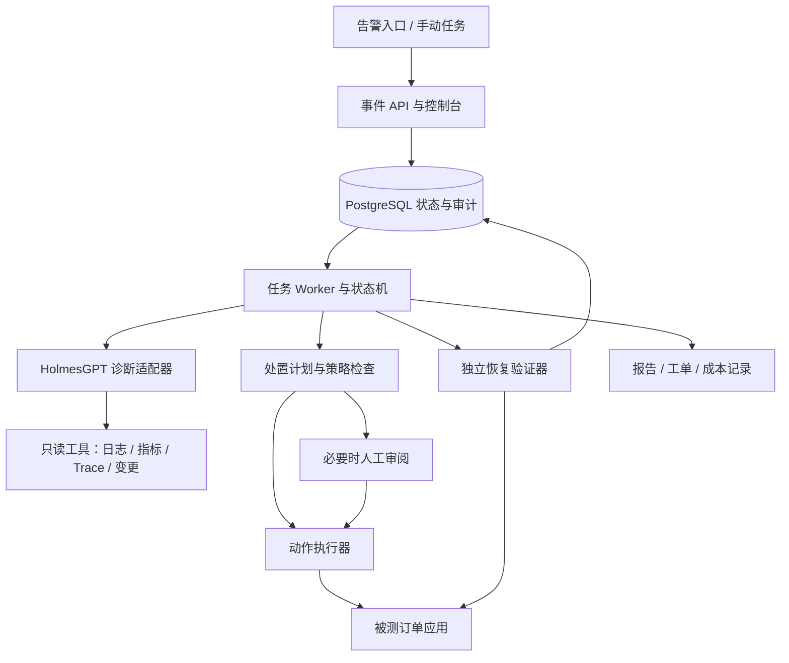

# 云巡 SRE Agent：线上故障诊断、处置与恢复验证项目计划书

版本：v1.0｜日期：2026-10-23｜状态：实施计划，尚未完成部署与效果验证

## 1. 项目目标与原则

参赛方向：赛道 B，AI Application，云原生智能体应用与场景创新。

项目目标：面向缺少专职 SRE 的中小研发团队，提供从告警接收、证据采集、根因判断、修复决策、受控执行到业务恢复验证、工单归档的完整应用。重点覆盖云原生应用的发布故障，同时处理依赖、资源和网络异常，避免把所有故障都误归因为近期发布。

价值主张：减少人工跨日志、监控、部署系统查证的时间；降低错误修复和盲目回滚；让故障处理过程、恢复结果及费用可追溯。

实施原则：

1. 项目效果、功能完整性、稳定性和可复现性优先；采用成熟开源基础，清楚说明自主工作。
2. 优化由同条件实验决定，不预设复杂架构、多 Agent 或新技术必然更好。
3. 首先完成一个真实运行的端到端闭环，再扩展故障覆盖、适配器和优化。
4. 报告真实测量结果，目标值不能写成实际成绩；不承诺获奖。
5. 方案匹配 UCloud 云服务、智慧运维和业务连续性需求，但不声称已有其客户或生产验证。

## 2. 与赛题评分及考核点的对应

截图中的整体评分为技术创新 40%、业务落地可行性 40%、代码质量 20%；以下子项是我们的工作分解，不是官方新增权重。

| 官方考核点 | 实施内容 | 提交证据 | 验收方法 |
|---|---|---|---|
| 场景价值与痛点 | 针对值班研发的故障处理，明确用户、触发事件、人工步骤 | 用户流程、访谈或试用记录、案例前后对照 | 至少完成真实运行环境的任务验证；争取 2–3 位研发/运维人员反馈，无法获得时如实注明 |
| Agent 任务拆解与自主决策 | 动态调查、候选根因、下一步工具选择、修复与转人工决策 | 结构化执行轨迹、证据和反证 | 在未参与调试的任务上测试，不能只演示固定脚本 |
| 工具调用准确性 | 类型化参数、目标解析、查询及动作接口 | 调用记录、参数校验结果、失败分类 | 统计无效参数、错误目标和重复调用 |
| 上下文与状态管理 | 持久化事件状态、证据摘要、检查点、预算 | 中断恢复演示、数据库结构说明 | 进程重启后续跑，不重复执行已完成变更 |
| 多步骤容错 | 超时重试、恢复失败后的再诊断、必要时撤销或转人工 | 故障注入与失败轨迹 | API 超时、权限不足、工具错误、执行结果未知等测试 |
| 云原生架构 | 容器化服务、Kubernetes 部署、独立 worker、数据库状态、探针 | 架构图、部署文件、选型说明 | 一条部署入口、健康检查、worker 重启恢复 |
| 工程完成度与 Demo | 完整控制台、事故详情、操作审阅、恢复证明、报告 | 在线或本地 Demo、3 分钟视频、代码仓库 | 全新环境安装及核心流程检查 |
| 成本与性能 | 每任务 token、工具耗时、端到端时延、资源占用 | 成本面板、评测报告、瓶颈分析 | 在相同任务集和预算下对照 |
| 技术创新 | 有针对性的证据组织、处置选择与业务验证改进 | 基线与消融、真实失败案例 | 只主张实验支持的改进，不把开源已有功能说成原创 |
| 代码质量 | 模块边界、类型、测试、格式检查、文档及许可证归属 | CI、测试结果、贡献与依赖清单 | 可复现构建、关键状态及动作测试通过 |

## 3. 用户流程与边界

主要用户：中小型软件团队值班研发、平台工程师；次要用户：云服务技术支持及教学实训人员。

典型流程：告警进入系统 → 合并同一事件的重复告警 → 展示业务影响 → 自动采证并生成候选根因 → 按证据继续调查 → 提出处置计划 → 根据策略自动执行或人工批准 → 独立探测验证 → 成功归档或撤销、再调查、转人工。

控制台用户能够：查看当前事件和影响服务；查看每个判断的证据；批准/拒绝具体变更；停止任务；查看恢复测试；导出报告；查看耗时与成本。

首版范围：一个订单业务应用、单 Kubernetes 集群、多服务、多类故障。系统对任务超出覆盖范围时输出已查证内容与下一步建议。生产环境的任意代码自动发布、数据库结构自动回退、多云全量管理不作为首版验收前提。

## 4. 成熟项目复用与选型

| 项目 | 采用方式 | 具体内容 | 验证与风险 |
|---|---|---|---|
| HolmesGPT | 优先作为诊断引擎，外层独立编排 | 查询实时观测数据、工具集、证据采集、模型适配 | 第一天验证调用接口、轨迹获取、结构化输出和 DeepSeek 接入；固定 commit 与镜像 |
| K8sGPT | 可选诊断工具或实现参考 | 规则分析器提取 Kubernetes 明确异常 | 验证增益和部署成本，避免与 HolmesGPT 重复查询 |
| STRATUS | 方法与代码参考；代码复用前核查许可证 | 状态机、诊断/缓解分工、动作后检查、撤销机制 | 不强行整体集成另一个编排框架；采用有助于结果的部分 |
| AIOpsLab | 评测环境优先候选 | 故障注入、负载、遥测和评测接口 | 做部署试跑，选可承担的子集；不能把改造子集分数叫完整官方分数 |
| ITBench | 任务设计参考及可选外部验证 | 业务故障、复杂依赖、任务规范 | 不同版本与任务目标分别记录 |
| Witty | 暂列后续候选 | 国内诊断流程及领域工具 | GitCode 页面尚未核实，不进入关键依赖 |

主路线：HolmesGPT 诊断适配器 + 我们的事件编排、动作执行、业务验证、评测和产品界面。开源复用不等于简单改名：自主贡献应明确落到上述模块及其测试结果。

第一天设不超过半天的集成验证窗口：若 HolmesGPT 接口稳定且能获得必要轨迹则沿用；若只能获得非结构化答案，增加输出校验适配层；若集成阻塞且无快速修复，则使用自己的轻量工具循环作为替代，并保留其作为对照候选。禁止同时维护两套完整主引擎。

许可证验收：检查实际固定版本的 LICENSE、NOTICE、依赖和再分发要求，创建 THIRD_PARTY_NOTICES 与贡献说明；竞赛原创要求以主办方解释为准，如对开源衍生作品有额外限制需核实。当前截图未明确禁止使用开源组件。

## 5. 技术架构

默认技术选择：Python/FastAPI 提供 API 与编排；React/TypeScript 提供控制台；PostgreSQL 保存事件、证据、动作和检查点；首版用数据库任务表和租约机制分配工作，避免为队列增加不必要的服务。达到并发瓶颈后再评估 Redis 队列。

模型：DeepSeek V4.1 Flash，模型名、端点和模式可配置；正式实现时核对官方接口与当时价格，记录实际 usage。普通筛查可不用模型，复杂诊断使用模型。更强模型升级为可选策略，需用户具备相应 API 与预算。

可观测性：Prometheus + Alertmanager + Loki 为首版；OpenTelemetry SDK 采集关键 Trace，Tempo 根据资源决定是否引入。优先保留 trace_id、service、release_id、timestamp，确保跨源关联。监控栈本身的 CPU/内存计入资源报告。

部署：本地 kind/k3s 或云端小集群；Helm 或 Kustomize 二选一作为标准部署入口。云端演示可部署于 UCloud，具体产品、价格与配额实施前核实，不以平台专属功能作为核心依赖。

服务划分：控制台/API、诊断/编排 worker、动作执行器、验证器、被测业务。首版允许 worker 内模块部署，但动作凭据和验证结果边界保持独立。

扩缩容：worker 可增加副本，通过租约与事件锁防止重复处置；首版验收 2 个并行独立事件。同一资源冲突时排队。HPA 是可选展示，只有负载测试支持才保留。

## 6. 核心模块与接口

### 6.1 事件管理

支持 Alertmanager webhook、手动触发和演练触发；幂等接收；依据服务、症状和时间窗口合并重复告警。展示影响范围而非仅展示告警数量。

状态：NEW → TRIAGING → INVESTIGATING → PLAN_READY → WAITING_APPROVAL（如需）→ EXECUTING → VERIFYING → RESOLVED。

分支：工具暂时故障进入 RETRY_WAIT；可撤销动作失败进入 COMPENSATING；不能确认安全继续则 ESCALATED；用户取消则 CANCELLED。执行结果未知时先查询真实状态，不能直接重试变更。

### 6.2 证据与诊断

Evidence 包含 id、来源、资源、查询条件、采集时间、故障时间窗、摘要、原始结果引用和内容哈希。诊断包含候选原因、支持证据 id、反证、未确认信息及下一项检查。缺乏证据的判断标记为假设。

发布时间相近只增加调查优先级；必须检查故障服务与变更范围是否相关。模型自报置信度不直接决定高风险操作。

工具输出先做时间过滤、字段筛选、去重及截断；保留原始结果供追查。日志和文档内容视为数据，不能变成执行指令。

### 6.3 工具注册

只读工具：query_metrics、query_logs、get_trace、get_resource_status、get_release_history、get_config_diff、get_dependency_health、search_runbook。

动作工具：rollback_deployment、restore_config、restart_workload、scale_within_limit、create_ticket、prepare_patch。每个接口定义 JSON Schema、超时、结果结构、目标命名空间、幂等键和审计字段。

create_ticket 首版在项目内部工单系统实现；GitHub/GitCode 对接为可选，实际外部写入需账号与授权。prepare_patch 生成可审阅补丁，不等价于自动发布。

### 6.4 处置计划和执行

ActionPlan 包含目标、前置检查、操作参数、预期变化、验证方法、撤销方法、权限和预算。策略由代码执行，模型不得自行修改策略。

演练环境可预先允许低风险、限定目标的动作；共享或生产环境由配置决定是否需要审批。用户批准绑定具体参数与版本，参数变更后重新审阅。

动作前保存相关状态，动作后读回实际状态。撤销仅对可补偿操作适用，不宣称所有操作具有数据库事务语义。涉及数据库迁移的发布先检查兼容性，不盲目回滚镜像。

### 6.5 恢复验证

由独立程序判断，不由诊断模型自行宣布成功。三层检查：资源健康、服务指标、业务事务。

业务样例：创建测试订单 → 查询订单 → 检查库存扣减符合预期 → 验证重复提交不重复扣减 → 清理测试记录。使用独立测试租户和幂等请求 id。

在持续负载下观察一个配置化窗口，首版默认 120 秒；同时检查错误率、延迟和新异常。报告区分服务暂时恢复、已验证恢复、根因长期修复。回滚可以成功缓解故障，但不能宣称代码缺陷已永久修复。

### 6.6 报告与界面

页面：事件列表、事件详情/执行时间线、证据与候选原因、操作计划审阅、验证结果、评测与成本面板。

报告字段：业务影响、时间线、根因与证据、已执行动作、验证结果、未解决问题、长期建议、人工介入、费用与耗时、软件版本。提供 Markdown/JSON 导出。

避免只做聊天窗口：默认以事件和处理结果为中心，聊天作为补充查询入口。

## 7. 测试业务与故障集

被测系统采用小型订单服务：gateway、order、inventory、PostgreSQL，以及负载发生器。实现真实服务调用和数据写入；可使用成熟示例应用，但优先选择资源可控、许可证清楚且便于验证业务不变量的版本。

| 故障类型 | 示例 | 正确处置/验证关注 |
|---|---|---|
| 配置回归 | 数据库地址或环境变量错误 | 确认配置差异并恢复；验证新订单 |
| 路由错误 | Service targetPort 不匹配 | 修正目标端口；验证完整请求链 |
| 应用回归 | 新版本订单接口异常 | 验证发布因果，回滚并检查数据 |
| 资源约束 | 内存限制过低、CPU 饱和 | 依据证据调整或降载，验证持续稳定 |
| 依赖不可用 | inventory/数据库不可达 | 修复依赖；不能误回滚无关服务 |
| 网络问题 | 服务间策略阻断 | 对照连通性和策略变化，定点恢复 |
| 干扰事件 | 故障前有无关发布 | 不误归因、不过度修复 |
| 工具失败 | 日志超时、缺少权限 | 有界重试、替代证据、转人工 |
| 表面恢复 | 健康端点正常但下单失败 | 业务验证应判定未恢复 |
| 不宜回滚 | 新版本包含不兼容数据变更 | 检查前置条件并转人工或选择其他方案 |

P0 实现前六类中的四类及至少一种干扰、一种表面恢复案例；P1 扩展其余类型。组合故障只在单故障稳定后添加。

故障注入控制器与 Agent 权限隔离；场景答案、注入命令、参考修复和评测内部数据不能被 Agent 读取。

## 8. 优化候选池与采纳方式

以下是可测试选项，不是全部必须实现。P0 为闭环所需，P1 为优先实验，P2 为资源允许时实验。

| 候选 | 预期收益 | 代价/可能退化 | 比较方法 | 优先级 |
|---|---|---|---|---|
| 类型化工具、参数校验 | 减少无效调用 | 接口开发 | 有效调用率 | P0 |
| 持久化状态、幂等与租约 | 中断续跑、防重复动作 | 状态实现复杂 | 杀进程与重试注入 | P0 |
| 独立业务恢复验证 | 减少假成功 | 探测维护及延迟 | 表面恢复故障检出 | P0 |
| 查询过滤、结果预算 | 降低上下文成本 | 截掉重要信息 | 成本与定位准确率 | P0 |
| 规则预诊断/K8sGPT | 快速识别明确异常 | 重复检查、规则覆盖有限 | 同任务耗时及成功率 | P1 |
| 变更时间线与差异工具 | 提高发布故障定位 | 可能过度归因发布 | 发布/非发布分组结果 | P1 |
| 服务依赖图引导采证 | 减少无效搜索 | 拓扑维护 | 工具次数、根因准确率 | P1 |
| 支持证据与反证结构 | 避免过早下结论 | 多调用开销 | 错误处置率 | P1 |
| SOP/RAG 检索 | 使用已有运维经验 | 过期经验可能误导 | 有/无检索对照；标注版本 | P1 |
| 成功案例记忆 | 重复故障更快 | 错误结论污染、测试泄漏 | 仅存已验证开发案例 | P1 |
| 工具结果缓存 | 降低重复查询 | 状态过期 | 按工具 TTL；变更后失效 | P1 |
| 并行只读查询 | 缩短耗时 | 服务压力与重复证据 | 延迟与资源峰值 | P1 |
| 上下文摘要与证据索引 | 长任务保持信息 | 摘要遗漏 | 长轨迹成功率 | P1 |
| 诊断/执行/验证职责分离 | 降低互相干扰 | 编排开销 | 单 Agent 与分工对照 | P1 |
| 模型路由与思考预算 | 控制成本 | 路由错误 | 单位成功任务成本 | P1 |
| 异常重试与循环检测 | 减少卡死和费用 | 过早终止 | 重复调用和完成率 | P0 |
| 告警聚合与优先级 | 降低重复处置 | 合并不同事故 | 告警风暴及漏处理测试 | P1 |
| 沙箱预演/灰度修复 | 降低错误变更影响 | 环境成本、差异 | 错误动作拦截及延迟 | P2 |
| 双假设诊断或审查 Agent | 识别遗漏 | 成本高，可能互相附和 | 困难任务子集对照 | P2 |
| 根因补丁生成与 CI 验证 | 从缓解推进永久修复 | 范围扩大 | 真实测试、补丁正确率 | P2 |
| 多事件协同与资源锁 | 并发处理 | 死锁/排队 | 资源冲突场景 | P1 |
| 多集群、更多云适配器 | 扩展部署适用性 | 分散开发精力 | 单集群稳定后再验证 | P2 |
| 用户反馈闭环 | 提高可用性 | 需要试用者 | 任务完成及反馈记录 | P1 |

采纳流程：在开发/验证集上一次改变一项，固定模型、数据和预算；记录效果、成本、失败类型。提升核心恢复效果或明显改善耗时/成本且无明显错误处置退化的选项进入候选；样本不足时追加验证。冻结最终配置后只运行一次正式测试批次，不根据测试结果反复挑配置。测试后修 bug 应标记新版本并完整重测。

## 9. 评测协议与验收标准

基线 B0：固定规则与处置脚本；B1：同模型单次诊断；B2：原始或最小配置 HolmesGPT；B3：我们的完整应用。B1 若没有执行能力只比较诊断指标，不把未实现执行记成算法修复失败。B2 的诊断与处置能力按实际版本分别标注。

建议数据划分：开发案例 12 个，验证案例 8 个，正式测试至少 20 个；按故障配置及变体划分，不能只替换名称造成伪独立。测试各重复 3 次，至少 60 次最终任务执行。预算紧张时缩小对照范围并明确披露，不能删掉失败任务。

统一模型版本、工具权限、输入信息、初始环境、负载、时限、调用与 token 上限。初始建议每任务最多 20 个推理轮次、30 个只读调用、3 次变更尝试、10 分钟；通过开发集确定后冻结。恢复验证等待计入总耗时，同时单独报告。

| 指标 | 定义 |
|---|---|
| 根因准确率 | 正确定位故障实体与原因的任务数 / 有根因标注任务数 |
| 业务恢复成功率 | 独立验证通过并保持观察窗口的任务数 / 适用恢复任务数 |
| 自主恢复率 | 无人工介入且恢复成功 / 适用恢复任务数 |
| 处置正确率 | 正确恢复或按预期转人工 / 全部任务；单独报告，不能替代恢复率 |
| 错误回滚率 | 对不应回滚任务执行回滚的次数 / 不应回滚任务数 |
| 假成功率 | Agent/系统宣称成功但独立验证未通过 / 宣称成功任务数 |
| 恢复时间 | 从故障注入和从告警触发两个起点分别记录，报告中位数/P95 |
| 成本 | 模型 usage + 付费工具费用；基础设施单独计费；另报总成本/成功任务 |
| 工具有效率 | 参数、目标和执行均有效的调用 / 全部调用 |

开发目标（不是已有成绩）：限定覆盖范围内恢复率争取 ≥80%；测试集中禁止动作执行数为 0；假成功数为 0；正常闭环无事件丢失。小样本零错误不代表生产绝对安全，报告样本数及案例。未达到恢复目标时分析失败、收缩声明范围或改进实现，不通过选择性排除任务提高分数。

重要质量门槛：执行器和状态机关键测试通过；环境重置可靠；评测器在无操作/标准修复/表面恢复三种控制测试下给出正确结果；实际使用日志和报告能够复查。

## 10. 开发任务与依赖

| 工作包 | 产物 | 前置 | 预计人时 |
|---|---|---|---:|
| W1 依赖与引擎验证 | 固定版本、集成试跑、许可证清单 | 无 | 6–10 |
| W2 被测业务与观测 | 订单应用、负载、指标/日志、发布记录 | W1 | 12–18 |
| W3 事件与状态机 | API、数据库、任务租约、轨迹 | W1 | 12–18 |
| W4 诊断与证据工具 | 诊断适配器、证据 schema、查询工具 | W2/W3 | 12–20 |
| W5 执行与验证 | 动作集、策略、业务探测、撤销 | W2/W3 | 16–24 |
| W6 产品界面与报告 | 控制台、审阅、结果和成本 | W3，可先用假数据开发 | 10–16 |
| W7 故障集及对照评测 | 注入器、重置、基线、结果 | W2/W4/W5 | 16–24 |
| W8 交付与优化 | 文档、视频、安装复核、少量优化 | 核心闭环 | 10–16 |

总计约 94–146 人时，是熟悉工具情况下的规划，集成问题可能增加投入。优化池不全部计入该估算。

## 11. 日程与里程碑

按截图 2026-11-06 截止安排；截止具体时刻待核实，以 11-05 完成提交包为内部目标。

| 日期 | 目标 | 完成判据 |
|---|---|---|
| 10-23～10-24 | 选型验证、环境、业务基线 | 模型诊断接口跑通；健康业务探测通过 |
| 10-25～10-26 | 最小完整闭环 | 一种真实故障从告警到恢复验证成功，轨迹可查 |
| 10-27～10-28 | 四类故障、状态与执行可靠性 | 重启续跑、错误动作阻断、报告生成 |
| 10-29～10-30 | 控制台与困难案例 | 非发布故障、假恢复与转人工可演示 |
| 10-31～11-01 | 基线评测和优先优化 | 有第一版对照数据，确定采用哪些优化 |
| 11-02～11-03 | 冻结配置、正式测试 | 原始轨迹、失败分析、成本和结果表齐全 |
| 11-04 | 新环境安装和材料 | 部署复现通过，文档及演示脚本完成 |
| 11-05 | 视频、检查、提交包 | Demo、技术文档、3 分钟视频、仓库、简历齐全 |
| 11-06 | 缓冲 | 仅修复阻塞交付的问题 |

如进度落后：首先删 P2、多集群、复杂 RAG、额外模型和灰度环境；保留完整闭环、真实故障、独立业务验证、对照数据与交付材料。不能以扩大功能清单牺牲可用性。

## 12. 资源、成本与测量

开发不要求 GPU。起步建议 Linux 环境 8 vCPU、16GB 内存、约 80GB 可用磁盘；完整观测栈或外部基准可能需要更多资源，按试跑测量决定。轻量开发配置和完整评测配置分别记录，不把推荐配置说成已验证最低要求。

模型费用按实际计费：C = 未缓存输入百万数×单价 + 缓存输入百万数×单价 + 输出百万数×单价。此前查得 DeepSeek Flash 空闲时段单价为 1/0.02/4 元，高峰为两倍；这些价格仅作预算参考，实施与报告时重新核实。

例如 600 次任务，每任务累计未缓存输入 8 万、计费输出 1.2 万 tokens，则空闲时段约 76.8 元，高峰约 153.6 元。思考 token 应纳入计费输出；查询结果及累计上下文导致的实际用量需通过前 20 个开发任务测量。此处假设不是实测。

初步直接支出预留：模型 100–250 元；CPU 云环境与磁盘 200–500 元；外部工具及机动 50–150 元，总计约 350–900 元。已有本地算力可减少云费用；完整多节点基准可能超出预算，需先测量。以上是预算额度，不是供应商报价。此前 200–300 元估算对应更轻量的应用版本，本计划包含观测栈、基准和更充分测试，因此上调。

控制措施：每任务预算上限、每日费用面板、模型超时、中断循环、云环境按需启停、结果保留与日志过期清理。云资源租赁与付费 API 执行在后续实施时根据用户授权配置，本计划本身不产生这些费用。

## 13. 工程质量与可复现交付

建议目录：backend/、frontend/、adapters/、tools/、verifier/、demo-app/、deploy/、evaluation/、docs/。场景答案与评测管理员数据只放评测侧，运行时不挂载给 Agent。

测试重点：事件去重、状态恢复、动作幂等、目标与参数校验、审批版本绑定、并发资源锁、补偿执行、评测器正确性。采用真实服务集成测试验证关键闭环；不以 mock 通过代替恢复结果。

CI：格式/静态检查、单元测试、关键集成测试、构建镜像；凭据只通过 Secret/环境配置传入；日志脱敏。记录模型、依赖锁、容器摘要、仓库 commit、配置与数据集版本。

交付清单：

- 可运行 Demo 与一条部署入口、环境检查脚本。
- 技术文档：用户痛点、架构、技术选型、Agent 工作机制、异常处理、成本与性能。
- 评测报告：配置、基线、原始结果、失败案例、适用边界与优化取舍。
- 代码仓库：README、许可证归属、自主贡献说明、配置模板和测试。
- 3 分钟演示视频及讲解稿。
- 简历中的项目描述，只填写已实现与实测数据。

3 分钟视频：0:00–0:20 展示用户问题；0:20–0:45 展示故障业务和告警；0:45–1:25 展示关键证据、推理和选择；1:25–2:05 展示处置与业务验证；2:05–2:35 展示一次避免错误回滚或转人工；2:35–3:00 展示对照效果、成本和可复现入口。必要时压缩等待画面并明确标注，不伪装实时速度。

## 14. 风险、取舍与决策记录

主要风险：开源版本变化、接口适配时间、模型工具调用不稳定、业务验证不充分、基准资源过大、无真实用户试用。分别通过固定版本、集成时间盒、结构化校验、独立验证器、缩减公开标注的任务子集和寻求外部反馈处理。

建立 OPTIMIZATION_LOG.md：候选、假设、代码版本、配置、任务集、效果、费用、是否采纳、原因。建立 CONTRIBUTIONS.md：上游来源、自主模块、修改点、实验贡献。建立 RESULTS.md：目标与实测分开，空白数据不填估计值。

本计划完成标准：形成可运行、可验证、可解释、可复现的参赛应用；在限定任务范围内说明真实优势与失败边界。功能增加必须服务用户效果和赛题考核。

## 15. 参考来源及证据边界

- 赛题依据：用户提供的两张比赛截图。
- HolmesGPT：https://github.com/HolmesGPT/holmesgpt
- K8sGPT：https://github.com/k8sgpt-ai/k8sgpt
- STRATUS：https://github.com/xlab-uiuc/stratus；https://arxiv.org/abs/2506.02009
- AIOpsLab：https://github.com/microsoft/AIOpsLab
- ITBench：https://github.com/itbench-hub/ITBench
- UCloud 智慧运维：https://www.ucloud.cn/site/solution/aiops.html
- DeepSeek 价格：https://api-docs.deepseek.com/zh-cn/quick_start/pricing/

上述项目在此前一轮完成公开资料调研，尚未在本地复现。兼容性、许可证、最终版本及实际效果在 W1 与后续评测中核实。本计划中的新模块、指标目标与成本假设均不代表已完成成果。
